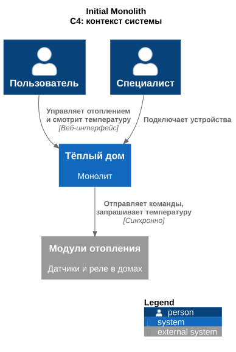
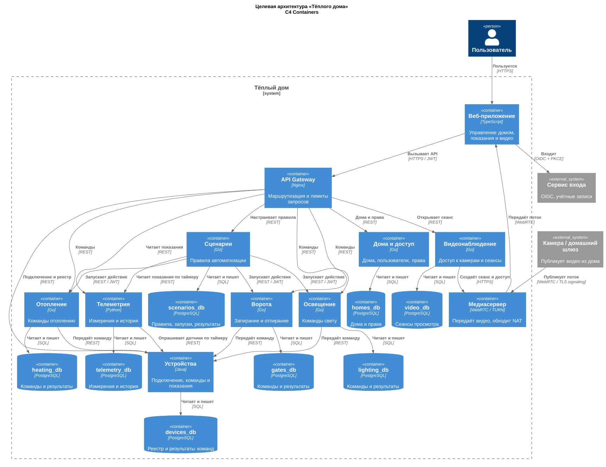
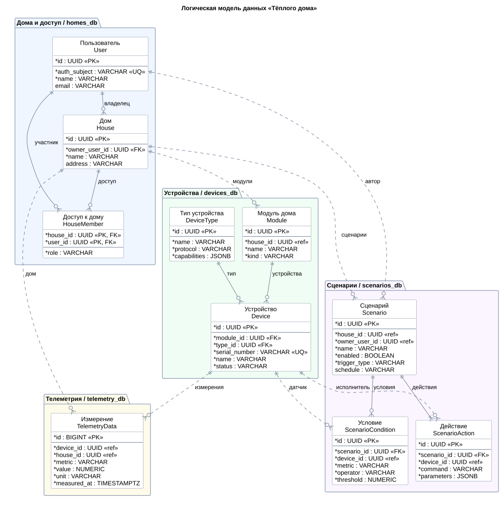

# Project_template

Это шаблон для решения проектной работы. Структура этого файла повторяет структуру заданий. Заполняйте его по мере работы над решением.

# Задание 1. Анализ и планирование

<aside>

Чтобы составить документ с описанием текущей архитектуры приложения, можно часть информации взять из описания компании и условия задания. Это нормально.

</aside

### 1. Описание функциональности монолитного приложения

**Управление отоплением:**

- Пользователь включает и выключает отопление через веб-интерфейс.
- Сервер отправляет команды домашнему модулю и ждёт ответа.
- Для подключения оборудования нужен специалист.

**Мониторинг температуры:**

- Сервер запрашивает показания датчиков
- Пользователь видит текущую температуру.

### 2. Анализ архитектуры монолитного приложения

| Аспект | Текущее решение |
| --- | --- |
| Приложение | Монолит на Go с Gin. Обработчики запросов, логика и доступ к данным находятся в одном приложении. |
| База данных | PostgreSQL. Таблица `sensors` хранит сведения о датчиках и последнее сохранённое значение. Истории измерений нет. |
| Взаимодействие | Синхронные запросы. В шаблоне датчики опрашиваются последовательно, тайм-аут каждого HTTP-запроса составляет 10 секунд. |
| Масштаб | По условию: 100 веб-клиентов и 100 модулей отопления. |
| Масштабирование | Приложение масштабируется целиком, отдельные функции масштабировать нельзя. |
| Развёртывание | По условию обновление требует остановки приложения. |

Такое решение просто разрабатывать и запускать. Для небольшого числа устройств это удобно, но добавление новых функций усложняет общий код.

### 3. Определение доменов и границы контекстов

В текущем монолите объединены учёт устройств, управление отоплением и мониторинг температуры. Для целевой системы предлагаются такие контексты:

| Контекст | За что отвечает |
| --- | --- |
| Дома и доступ | Пользователи, дома и права управления. |
| Управление устройствами | Реестр устройств, их типы, возможности и подключение к дому. Адаптеры обеспечивают поддержку протоколов партнёров. |
| Отопление | Команды отоплению и результаты их выполнения. |
| Освещение | Включение и выключение света. |
| Ворота | Запирание и отпирание ворот. |
| Видеонаблюдение | Камеры и доступ к видеопотоку. |
| Телеметрия | Приём, хранение и просмотр измерений. |
| Сценарии | Пользовательские условия и действия для автоматизации. |

Каждый контекст отвечает за свои данные. Обмен происходит через API или события, без прямого изменения чужих таблиц. Управление устройствами ведёт реестр, телеметрия хранит показания, а контексты управления выполняют команды. Новый тип оборудования добавляется через описание его возможностей и адаптер протокола.

### 4. Проблемы монолитного решения

- Подключение требует выезда специалиста, поэтому массовое внедрение обходится дороже и занимает больше времени.
- Поддерживается только отопление. Свет, ворота, камеры и сценарии ещё предстоит добавить.
- Последовательный опрос увеличивает время ответа при росте числа датчиков.
- Все функции обновляются и масштабируются вместе. Сбой общего процесса может затронуть всю систему.
- В шаблоне нет истории измерений, модели домов и проверки прав доступа.
- Свежие показания при чтении не сохраняются. При ошибке опроса API может вернуть старое значение без признака сбоя обновления.

Переход стоит начать с выделения устройств и телеметрии с сохранением существующего API. Затем добавить дома, права доступа, самостоятельное подключение и новые функции. Перед массовым запуском провести пилот на небольшой группе домов.

### 5. Контекстная диаграмма C4



[Исходник PlantUML](docs/diagrams/initial/context.puml) · [Открыть SVG](docs/diagrams/initial/context.svg)

Пользователь управляет отоплением и смотрит температуру, специалист подключает оборудование. Сервер отправляет команды и запрашивает показания. PostgreSQL находится внутри системы и на уровне контекста отдельно не показан.

Генерация SVG из корня репозитория:

```sh
java -jar /path/to/plantuml.jar -charset UTF-8 -tsvg docs/diagrams/initial/context.puml
```

# Задание 2. Проектирование микросервисной архитектуры

Диаграммы описывают целевую систему (To-Be). Реализация будет идти поэтапно.

Сервисы общаются напрямую через REST. Команда и её результат передаются в одном HTTP-вызове. Телеметрия по таймеру запрашивает показания у сервиса устройств, а сценарии периодически читают телеметрию и проверяют условия. Для оборудования предполагается HTTP API на устройстве или домашнем шлюзе.

**Диаграмма контейнеров (Containers)**

Сервисы, базы данных и основные взаимодействия на одной схеме. Проверки прав, проверка камеры в реестре устройств и обмен с оборудованием раскрыты на уровне компонентов.



[Открыть SVG](docs/diagrams/target/containers.svg) · [PlantUML](docs/diagrams/target/containers.puml)

**Диаграммы компонентов (Components)**

| Сервис | Диаграмма | Исходник |
| --- | --- | --- |
| Дома и доступ | [SVG](docs/diagrams/target/components/homes.svg) | [PlantUML](docs/diagrams/target/components/homes.puml) |
| Управление устройствами | [SVG](docs/diagrams/target/components/devices.svg) | [PlantUML](docs/diagrams/target/components/devices.puml) |
| Отопление | [SVG](docs/diagrams/target/components/heating.svg) | [PlantUML](docs/diagrams/target/components/heating.puml) |
| Освещение | [SVG](docs/diagrams/target/components/lighting.svg) | [PlantUML](docs/diagrams/target/components/lighting.puml) |
| Ворота | [SVG](docs/diagrams/target/components/gates.svg) | [PlantUML](docs/diagrams/target/components/gates.puml) |
| Видеонаблюдение | [SVG](docs/diagrams/target/components/video.svg) | [PlantUML](docs/diagrams/target/components/video.puml) |
| Телеметрия | [SVG](docs/diagrams/target/components/telemetry.svg) | [PlantUML](docs/diagrams/target/components/telemetry.puml) |
| Сценарии | [SVG](docs/diagrams/target/components/scenarios.svg) | [PlantUML](docs/diagrams/target/components/scenarios.puml) |

Генерация SVG из корня репозитория:

```sh
java -jar /path/to/plantuml.jar -charset UTF-8 -tsvg "docs/diagrams/target/*.puml" "docs/diagrams/target/components/*.puml"
```

# Задание 3. Разработка ER-диаграммы

Логическая модель основных сущностей целевой системы. Группы показывают, какой сервис хранит данные.



[Открыть SVG](docs/diagrams/target/er.svg) · [PlantUML](docs/diagrams/target/er.puml)

**Сущности**

| Сервис | Сущности | Назначение |
| --- | --- | --- |
| Дома и доступ | User, House, HouseMember | Пользователи, владельцы домов и доступ других участников. |
| Устройства | Module, DeviceType, Device | Комплекты устройств в доме, типы и подключённое оборудование. |
| Телеметрия | TelemetryData | История измерений с временем, значением и единицей измерения. |
| Сценарии | Scenario, ScenarioCondition, ScenarioAction | Правила автоматизации, условия и команды устройствам. |

**Связи и правила**

- У дома один владелец. Пользователь может владеть несколькими домами. Дополнительный доступ задаёт HouseMember: связь пользователей и домов многие-ко-многим, роль `manager` или `viewer`. Владелец имеет полный доступ без отдельной записи в HouseMember.
- Дом содержит модули, модуль содержит устройства. Здесь модуль означает подключённый комплект, например отопление с датчиком и реле. Устройство относится к одному модулю и одному типу. Его дом определяется через Module.house_id.
- DeviceType описывает протокол и возможности оборудования. Новый тип добавляется записью в справочник; поддержку протокола обеспечивает адаптер сервиса устройств.
- У устройства может быть много измерений. TelemetryData.house_id хранит дом на момент измерения и позволяет выбирать показания по дому.
- Сценарий принадлежит дому и пользователю с доступом к нему. У него одно или несколько действий. Все устройства в условиях и действиях должны относиться к этому дому.
- Для `trigger_type = condition` требуется хотя бы одно условие; запуск происходит, когда все условия стали выполнены. Для `trigger_type = schedule` заполняется расписание, условия отсутствуют. Команда и её параметры должны поддерживаться устройством.

**Как читать схему**

`PK` обозначает первичный ключ, `FK` внешний ключ внутри одной БД, `UQ` уникальность, `*` обязательное поле. Пара house_id и user_id составляет общий ключ HouseMember. auth_subject связывает пользователя с внешним сервисом входа.

`ref` и пунктирные линии обозначают ссылки по ID между сервисами. Их проверяют через API, внешних ключей между разными БД нет. На концах линий `||` означает ровно одну запись, `o{` от нуля до многих, `|{` от одной до многих.

Генерация SVG из корня репозитория:

```sh
java -jar /path/to/plantuml.jar -charset UTF-8 -tsvg docs/diagrams/target/er.puml
```

# Задание 4. Создание и документирование API

### 1. Тип API

Используется REST API с JSON и синхронными HTTP-вызовами. Это соответствует архитектуре: сервис получает ответ на команду или запрос показаний сразу в рамках вызова. Телеметрия опрашивает устройства по таймеру, брокер сообщений не используем (тк рассматривается дальше по курсу).

### 2. Документация API

[Спецификация OpenAPI 3.0.3](docs/api/openapi.yaml) · [Страница Swagger UI](docs/api/index.html)

Описаны пять операций двух сервисов. Общий префикс путей: `/api/v1`.

| Сервис | Метод и путь | Назначение |
| --- | --- | --- |
| Устройства | `POST /devices` | Подключить устройство к существующему модулю по одноразовому коду. |
| Устройства | `GET /devices/{device_id}` | Получить данные, возможности и последнее известное состояние устройства. |
| Устройства | `POST /devices/{device_id}/commands` | Выполнить команду отопления, света или ворот и получить результат. |
| Устройства | `GET /devices/{device_id}/readings` | Запросить свежие показания для сборщика телеметрии. |
| Телеметрия | `GET /telemetry` | Получить последние сохранённые измерения дома с фильтром по устройству и показателю. |

Состояние устройства меняется через команду. Для последнего значения датчика запрос телеметрии содержит `house_id`, `device_id`, `metric` и `limit=1`.

Все операции используют JWT и проверку прав. При чтении доступны роли владельца, manager и viewer; для подключения и управления нужны права владельца или manager. Команды вызывают сервисы управления от имени пользователя, свежие показания запрашивает служебный клиент телеметрии.

В спецификации есть схемы JSON, блоки `examples` для запросов, ответов и ошибок. Успешные ответы: `200` и `201`. Ошибки описаны кодами `400`, `401`, `403`, `404`, `409`, `422`, `500`, `503`, `504`. При тайм-ауте команды результат `unknown`, повтор использует тот же `command_id`.

Для просмотра Swagger UI выполните из корня репозитория:

```sh
python -m http.server 8082 --bind 127.0.0.1 --directory docs/api
```

Откройте [документацию в браузере](http://127.0.0.1:8082). Swagger UI загружается из CDN, поэтому нужен интернет. Файл также можно импортировать в [Swagger Editor](https://editor.swagger.io/).

Это контракт будущего API. Адреса `.example` условные, отправка запросов в странице просмотра отключена.

# Задание 5. Работа с docker и docker-compose

Добавлен [temperature-api на Go](apps/temperature-api/main.go) без сторонних библиотек и [Dockerfile](apps/temperature-api/Dockerfile). Сервис работает на порту 8081 и возвращает случайную температуру от 15 до 30 °C, время измерения и данные датчика.

Поддерживаются `GET /temperature?location=Living%20Room` и `GET /temperature/{id}`. Второй маршрут использует монолит. Соседние показания одного датчика не повторяются.

В [docker-compose.yml](apps/docker-compose.yml) настроены три сервиса: PostgreSQL, temperature-api и smart_home. База создаётся через `POSTGRES_DB`, таблицы через [init.sql](apps/smart_home/init.sql). Монолит ждёт готовности зависимостей.

Запуск из корня репозитория:

```sh
docker compose -f apps/docker-compose.yml up --build -d --wait
```

Для проверки импортируйте [коллекцию Postman](apps/smarthome-api.postman_collection.json), выполните `Create Sensor`, затем несколько раз `Get All Sensors`. Значения температуры и время измерения будут обновляться.

Адреса: монолит http://localhost:8080, генератор температуры http://localhost:8081. Подробности запуска и проверки описаны в [apps/README.md](apps/README.md).

# Задание 6. Разработка MVP

Добавлены два микросервиса с простой логикой:

- [device-api](apps/device-api) на Java / Spring Boot: создание, чтение, изменение и удаление датчиков.
- [telemetry-api](apps/telemetry-api) на Python / Flask: сохранение показаний и чтение истории.

Монолит сохраняет API `/api/v1/sensors`, но передаёт операции с датчиками в device-api по HTTP. При создании и чтении температурного датчика он получает значение из temperature-api и сохраняет его в telemetry-api. История доступна через `GET /api/v1/sensors/{id}/telemetry?limit=10`.

Это промежуточный этап миграции: device-api работает с существующей таблицей `sensors` в PostgreSQL. Если убрать `DEVICE_API_URL` из окружения монолита, включится прежняя работа с БД. История телеметрии хранится отдельно в SQLite и сохраняется в Docker-томе.

У обоих сервисов есть Dockerfile. Общий [docker-compose.yml](apps/docker-compose.yml) запускает пять сервисов:

```sh
docker compose -f apps/docker-compose.yml up --build -d --wait
```

Адреса, примеры запросов и ограничения учебного MVP описаны в [apps/README.md](apps/README.md).
